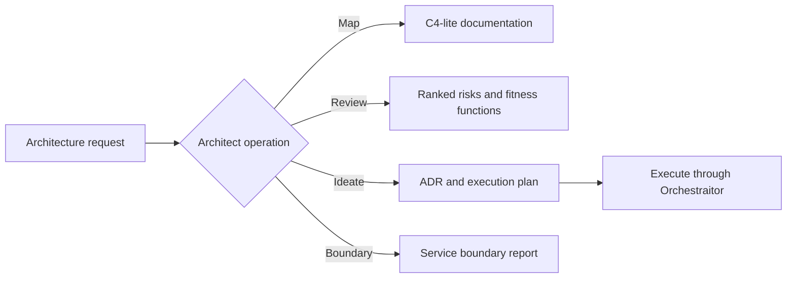

# Architecture Domain

Evidence-backed architecture maps, reviews, target decisions, and service boundaries. Class-level refactors belong to Plan; product requirements belong to Docs.

## Quick path

1. Install `architecture` or the multi-primary profile.
2. Select `architect` or use an entry point below.
3. Review files under `<docfolder>/architecture/` or `.ai/architect/`; execute any plan through `orchestraitor`.

## Entry points

| Entry | Use | Result |
|---|---|---|
| `/arch-map` | Document current architecture | Adaptive C4-lite documentation |
| `/arch-review` | Rank architecture risks | Issues and fitness functions |
| `/arch-ideate` | Choose a target architecture | ADR and neutral execution plan |
| `/boundary-inspector` | Inspect one service | Evidence-backed boundary map |

`architect` executes each operation inline. Dependency commands require authorization and degrade to inventory-only results; audit execution never installs tools. See the [Graphify guide](../../docs/graphify.md) for graph setup.

After changing this domain, run the affected [Architecture manual tests](manual-tests.md).

## Components

| Type | Name | Purpose |
|---|---|---|
| Agent (primary) | `architect` | Coordinates all architecture operations directly |
| Command | `/arch-ideate` | Produces ADR and executable change |
| Command | `/arch-map` | Generates or refreshes C4-lite docs |
| Command | `/arch-review` | Ranks architecture and dependency risks |
| Command | `/boundary-inspector` | Maps one service boundary |
| Skill | `oc-adr` | Records architecture decisions |
| Skill | `oc-arch-ideate` | Designs target architecture and work |
| Skill | `oc-arch-map` | Creates evidence-backed C4-lite docs |
| Skill | `oc-arch-state` | Records verified current architecture |
| Skill (handoff-only) | `oc-conventions` | Names implementation conventions for SDD |
| Skill (handoff-only) | `oc-java-test` | Names Java testing guidance for implementation |
| Skill | `oc-dep-audit` | Audits current dependency evidence |
| Skill | `oc-patterns` | Applies patterns to evidenced forces |
| Skill | `oc-kiss` | Rejects speculative architecture complexity |
| Skill | `oc-arch-issues` | Ranks gaps and fitness functions |
| Skill | `oc-plan-format` | Drafts one neutral execution plan |
| Skill | `oc-routing` | Selects skills for implementation work |
| Skill | `oc-boundary` | Maps service contracts |
